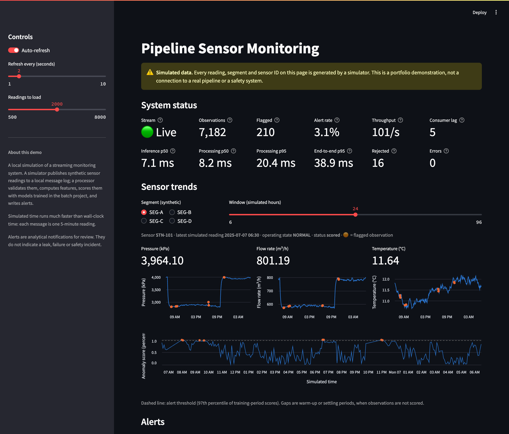
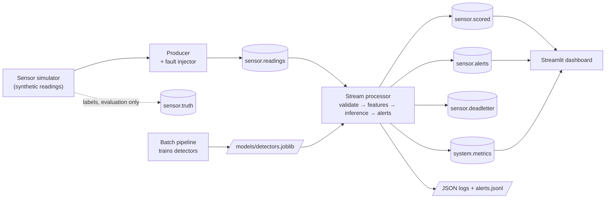
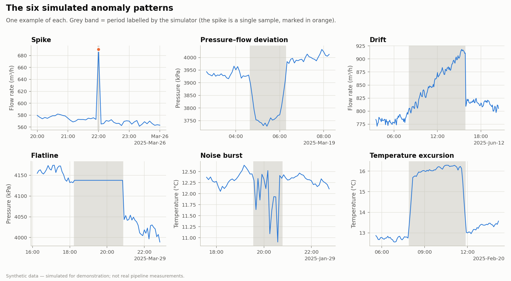
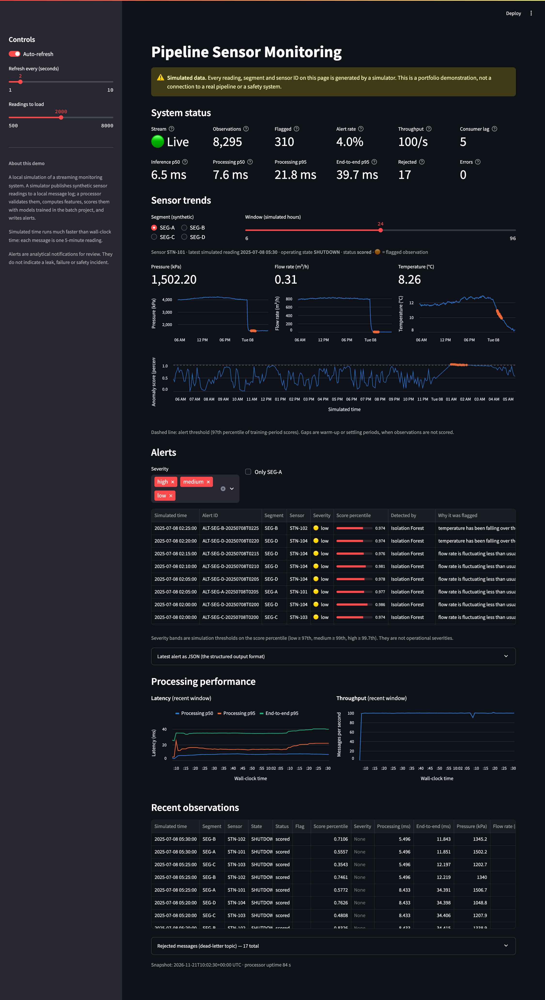
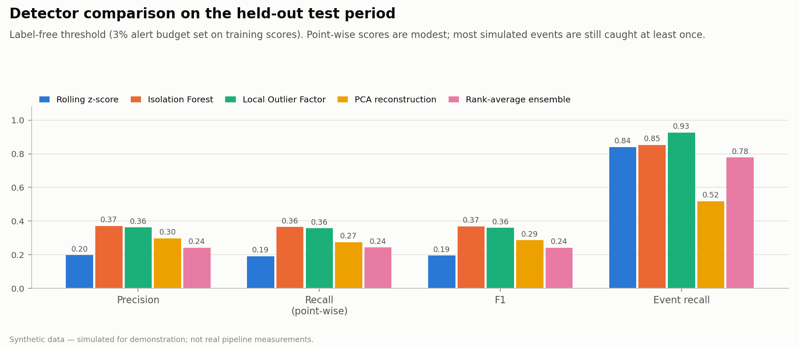
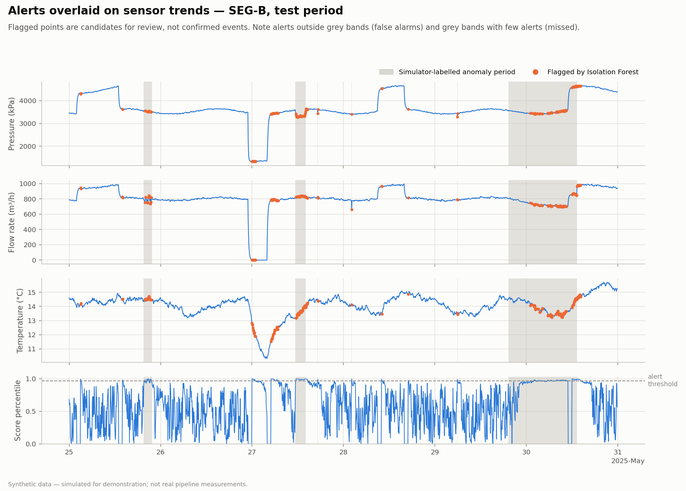
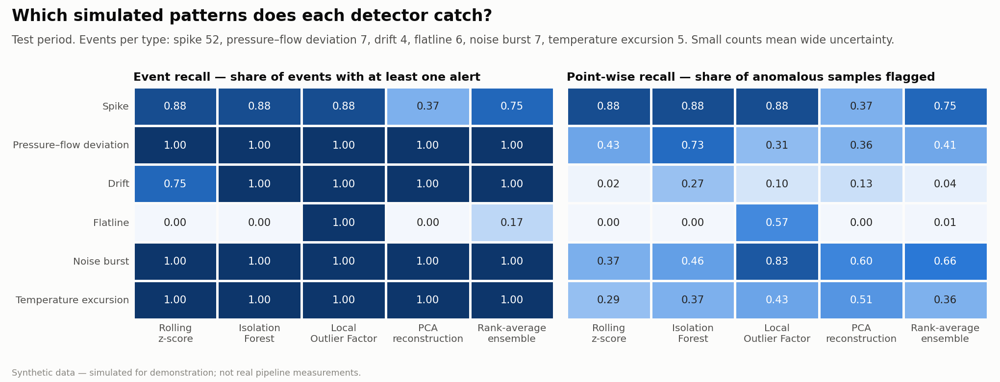

# Pipeline Sensor Anomaly Detection: Batch Study and Streaming Simulation

A two-part data science project on **synthetic** pipeline-style sensor data (pressure, flow rate, temperature):

1. **Batch study** — a simulator, data validation, leakage-safe features, four anomaly detectors compared fairly, and
   an honest evaluation.
2. **Streaming simulation** — the same models running in a streaming-style architecture: a producer, a local
   message log, a low-latency processor, structured alerts, latency monitoring, a live dashboard and Docker files.

> **Important disclosure**
> * All data is **simulated** by code in this repository. Segment and sensor identifiers are invented.
> * The "streaming system" is a **local simulation on one machine**. It is not connected to a real pipeline, SCADA
>   system, message cluster or cloud service, and nothing is deployed anywhere.
> * Detection metrics measure recovery of **anomaly patterns injected by the simulator**, not real-world performance.
> * This is **not** a leak-detection, safety or operational intervention system. An alert is an analytical
>   notification for human review; it does not mean anything is wrong.



## Project overview

| | Batch study | Streaming simulation |
|---|---|---|
| Data | 207,360 simulated readings, 180 days, 4 segments | 34,560 unseen simulated readings (30 days, different seed), replayed as a stream |
| Processing | pandas over the full history | One observation at a time, micro-batched inference |
| Models | Rolling z-score, Isolation Forest, LOF, PCA, ensemble | Isolation Forest + LOF, loaded from the batch run |
| Output | Figures, metrics, reports | JSON alerts, scored records, metrics, JSON logs, dashboard |
| Tests | 56 | 70 more (126 in total) |

**Headline results (all on simulated data, measured locally):**

* Batch, held-out 36 days: Isolation Forest and LOF reach F1 ≈ 0.36–0.37 point-wise, about twice the per-sensor
  statistical baseline (0.19), and flag 85 % and 93 % of simulated events.
* Streaming, 30 unseen days at 200 messages/s: median processing time **7.6 ms** per micro-batch, median end-to-end
  **23 ms** (p95 41 ms), **0 processing errors** over 34,558 messages, and a measured capacity of about
  **1,500 messages/s** when draining a backlog.
* Streaming features and scores are **identical** to the batch pipeline's on the same data (enforced by tests).

## Business problem

Pipeline systems produce continuous sensor data that people cannot inspect reading by reading. Anomaly detection
can rank observations by how unusual they are, so analysts look at the most unusual first. A batch notebook shows
whether that works on history; a streaming design shows what it takes to do it as data arrives: validating messages,
keeping features consistent with training, bounding latency, and producing alerts a person can act on.

An anomaly is a statistical statement ("unlike recent history"). It does not by itself indicate a leak, failure,
dangerous condition or operational incident.

## Architecture



The message log is a **SQLite file with Kafka-like semantics** (topics, offsets, consumer groups, replay). Kafka and
Redpanda were considered and judged excessive for a single-machine simulation; the broker sits behind a small
interface so it could be swapped, but no Kafka integration is included or claimed. Full reasoning, topic schemas and
delivery guarantees: [`docs/streaming_architecture.md`](docs/streaming_architecture.md).

## Streaming workflow

1. The **simulator** generates readings for four synthetic segments; the **producer** publishes them at a set rate.
2. The **processor** polls a micro-batch and **validates** each message. Unusable messages go to a dead-letter topic.
3. Duplicates and late messages are dropped; missing timestamps become explicit gap rows; missing values are
   forward-filled for at most one hour.
4. **Features** are updated incrementally from a small per-segment buffer.
5. **Inference** scores all ready observations in the batch with Isolation Forest and LOF.
6. Observations above a detector's threshold become **structured alerts**.
7. Outputs and the consumer offset are committed in **one transaction**.
8. **Metrics** and **JSON logs** are emitted throughout; the **dashboard** reads the topics.

| Situation | Handling | Count in the 30-day run |
|---|---|---|
| Invalid JSON / unparseable timestamp | Dead-letter topic with reason code | 73 |
| Missing, non-numeric or out-of-range value | Treated as missing, forward-filled (max 1 h) | 168 values filled |
| Duplicate message | Dropped | 42 |
| Message never arrives | Gap row inserted | 117 rows |
| Unexpected exception | Logged, counted, dead-lettered; stream continues | 0 |

## Data simulator

Source: [`data_generation.py`](src/pipeline_anomaly/data_generation.py), reused by
[`streaming/simulator.py`](src/pipeline_anomaly/streaming/simulator.py). Field definitions:
[`docs/data_dictionary.md`](docs/data_dictionary.md).

* **Fields:** timestamp, synthetic segment ID (`SEG-A`…`SEG-D`), synthetic sensor ID (`STN-101`…`STN-104`),
  pressure (kPa), flow rate (m³/h), temperature (°C), operating state.
* **Normal patterns:** four operating states; pressure = static head + friction ∝ flow²; temperature with seasonal
  and daily cycles and a thermal lag; autocorrelated noise.
* **Gradual change:** seasonal temperature trend, daily flow cycle, and simulated sensor drift.
* **Anomaly scenarios (labelled, simulated):** spike, pressure–flow deviation, drift, flatline (stuck value), noise
  burst, temperature excursion. They are patterns for analysis, not representations of real leaks or incidents.
* **Transport faults (stream only):** 1 % of messages are nulled, corrupted, duplicated or dropped to exercise
  error handling.
* The stream uses a **different seed and later dates** than the training data, so it is unseen. Labels travel on a
  separate topic that the processor never reads.

Public datasets were considered first; see [`docs/dataset_investigation.md`](docs/dataset_investigation.md).



## Anomaly detection

**Features (16, no look-ahead):** robust z-scores, sample-to-sample changes, EWMA residuals and volatility ratios per
sensor, plus a physics-based pressure–flow residual and its trend. Rows within 60 minutes of an operating-state
change ("settling") are not monitored.

**Detectors:** rolling z-score baseline, Isolation Forest, Local Outlier Factor, PCA reconstruction error, and a
rank-average ensemble. Thresholds are label-free: each detector alerts above the 97th percentile of its own
training scores.

**In the stream:** Isolation Forest (best ranking in the batch study) and LOF (the only detector that caught stuck
sensors) run together; an observation is flagged if either exceeds its threshold.

**Keeping streaming consistent with training.** The batch feature code was too slow to call per message (about
40 ms), so features are recomputed incrementally with NumPy (about 0.1–0.5 ms). To make sure the two can never
drift apart, tests require the streaming engine to reproduce the batch features and scores exactly on data that
includes missing values, sentinel values and gaps. Details: [`docs/methodology.md`](docs/methodology.md).

## Alerts

Each flagged observation produces a JSON alert (topic `sensor.alerts` and `runtime/alerts.jsonl`). A real example
from the measured run, shortened ([more](reports/sample_alerts.json)):

```json
{
  "alert_id": "ALT-SEG-C-20250702T0530",
  "observation_timestamp": "2025-07-02 05:30:00",
  "segment_id": "SEG-C",
  "sensor_id": "STN-103",
  "severity": "high",
  "anomaly_score_percentile": 0.999,
  "detection_methods": ["Isolation Forest", "Local Outlier Factor"],
  "readings": {"pressure_kpa": 2953.4, "flow_m3h": 715.26, "temperature_c": 9.996},
  "explanation": "Local Outlier Factor scored this observation at the 99.9th percentile of training-period scores (alert threshold: 97th). Largest deviations from typical values: flow rate fell sharply since the previous reading; flow rate is below its recent smoothed trend; pressure is higher than expected for the current flow rate.",
  "episode_id": "EP-SEG-C-20250702T0530",
  "latency_ms": {"feature_ms": 0.141, "inference_ms": 11.422, "processing_ms": 14.324, "end_to_end_ms": 39.543, "batch_size": 10},
  "simulated": true,
  "disclaimer": "Simulated data. Analytical notification for human review only; not an indication of a leak, equipment failure or safety incident."
}
```

* **Severity** is a documented band on the score percentile (low ≥ 97th, medium ≥ 99th, high ≥ 99.7th of training
  scores). These are simulation thresholds, not operational severities.
* **Explanation** names the three features furthest from their typical values. It describes what deviated, not why.
* **Episodes** group alerts on one segment that are under 30 simulated minutes apart.
* A test checks that alert text never claims a leak, failure or incident.

## Dashboard

`streamlit run dashboard/app.py` opens a read-only, auto-refreshing view of the simulated stream: system status,
throughput and latency, sensor trend charts with flagged points, the anomaly score against its threshold, a
filterable alert table with explanations, the latest alert as JSON, recent observations and rejected messages.
Every page states that the data is simulated.



## Docker

One image runs three services (producer, processor, dashboard) that share a volume holding the message log.
Models are trained on the committed synthetic dataset during the image build. No secrets are needed.

```bash
docker compose up --build
```

Then open http://localhost:8501. Optional settings (rate, simulated days, fault rate, port) are documented in
[`.env.example`](.env.example). `docker compose down -v` removes the simulated data volume.

> **Not verified on the development machine.** `docker compose config` validates, but the Docker engine was not
> available when this was built, so the image build and the three containers have **not** been run. The same three
> processes were run and tested locally without Docker.

## Testing

```bash
pytest
```

126 tests, under 20 seconds.

| Area | Examples of what is checked |
|---|---|
| Sensor generation | Deterministic; time-ordered; labels never in reading messages; stream seed ≠ training seed |
| Data validation | Injected defects are found; forward-fill is causal and limited; rejected message reasons |
| Streaming messages | Broker offsets, consumer groups, durability, atomic publish-and-commit, invalid JSON |
| Feature processing | No look-ahead; **streaming features equal batch features** on defective data |
| Model inference | Detector contract; **streaming scores equal batch scores**; settling rows never alert |
| Alert generation | Schema, severity bands, unique IDs, JSON-safe, no incident wording, one alert per flagged row |
| Latency calculation | Percentiles on known data; throughput and capacity with a fake clock |
| Error handling | A failing message or a failing model is logged and counted without stopping the stream |

## Setup

```bash
git clone <your-repo-url>
cd pipeline-sensor-anomaly-detection
python -m venv .venv && source .venv/bin/activate
pip install -r requirements.txt
pip install -e .
```

Python 3.10+ (developed on 3.13).

## Running the system

```bash
python -m pipeline_anomaly.pipeline
```

Batch study: regenerates data, features, models, metrics and figures (about a minute). The streaming system loads
the models this creates, and trains them itself if they are missing.

```bash
python -m pipeline_anomaly.streaming.run_demo
```

Finite streaming run with measurements: 30 simulated days at 200 messages/s, then a backlog drain (about four
minutes). Writes [`reports/streaming_run_summary.md`](reports/streaming_run_summary.md).

```bash
python -m pipeline_anomaly.streaming.run_demo --live
```

Continuous simulated stream for the dashboard (Ctrl+C to stop). In a second terminal:

```bash
streamlit run dashboard/app.py
```

The producer and processor can also be started separately
(`python -m pipeline_anomaly.streaming.producer`, `python -m pipeline_anomaly.streaming.processor`).
Shortcuts (`make stream-demo`, `make stream-live`, `make dashboard`, `make docker-up`) are in the [`Makefile`](Makefile). The notebook is rebuilt with
`python scripts/build_notebook.py` and executed with `jupyter nbconvert`.

## Results

### Streaming run (simulated data, measured on an Apple-silicon laptop)

30 simulated days, 34,558 messages, 200 messages/s offered, 1 % injected message faults.

| Latency (ms) | p50 | p95 | p99 |
|---|---|---|---|
| Validation + features, per message | 0.13 | 0.47 | 0.69 |
| Model inference, per micro-batch (mean 10 messages) | 5.9 | 13.4 | 38.0 |
| Total processing, per micro-batch | 7.6 | 18.0 | 49.9 |
| End to end (produced → scored) | 23.0 | 41.0 | 418 |

| Throughput and volume | |
|---|---|
| Achieved in the paced run | 200 messages/s (all offered load) |
| Capacity when draining a backlog | 1,522 messages/s (0.47 ms per message, batches of 64) |
| Observations processed / scored / flagged | 34,443 / 32,747 / 1,577 |
| Rejected / duplicates / processing errors | 73 / 42 / 0 |

End-to-end time includes the producer's 50 ms publish ticks and the processor's 20 ms poll interval. The p99 of
418 ms reflects a short backlog at start-up. These figures will differ on other hardware.

| Detection on the stream (simulated labels) | Precision | Recall | F1 | False-positive rate | Event recall |
|---|---|---|---|---|---|
| Either detector (alert rule) | 0.32 | 0.43 | 0.36 | 3.3 % | 97 % of 64 events |
| Isolation Forest alone | 0.35 | 0.28 | 0.31 | 1.8 % | 88 % |
| LOF alone | 0.36 | 0.33 | 0.34 | 2.0 % | 97 % |

All six pattern types were caught at event level (spikes 95 %, others 100 %, on 4–8 events each apart from 40
spikes). Drift was first flagged a median of 280 minutes after onset. Full output:
[`reports/streaming_run_summary.md`](reports/streaming_run_summary.md).

### Batch study (held-out final 36 days, simulated labels)

| Detector | Precision | Recall | F1 | ROC-AUC | PR-AUC | Event recall |
|---|---|---|---|---|---|---|
| Rolling z-score (baseline) | 0.20 | 0.19 | 0.19 | 0.60 | 0.14 | 0.84 |
| **Isolation Forest** | **0.37** | **0.36** | **0.37** | **0.85** | **0.26** | 0.85 |
| **Local Outlier Factor** | 0.36 | 0.36 | 0.36 | 0.70 | 0.24 | **0.93** |
| PCA reconstruction | 0.30 | 0.27 | 0.29 | 0.70 | 0.15 | 0.52 |
| Rank-average ensemble | 0.24 | 0.24 | 0.24 | 0.75 | 0.15 | 0.78 |

* The physics-based pressure–flow residual alone reaches ROC-AUC 0.81; no per-sensor statistic exceeds 0.61.
* Ignoring alerts for 60 minutes after a state change raised Isolation Forest precision from 0.16 to 0.37.
* Only LOF caught stuck sensors; slow drift was found hours late; the ensemble did not beat its best member.

Details: [`reports/evaluation_report.md`](reports/evaluation_report.md),
[`reports/business_analysis.md`](reports/business_analysis.md),
[`notebooks/pipeline_anomaly_detection.ipynb`](notebooks/pipeline_anomaly_detection.ipynb).



| | |
|---|---|
|  |  |

## Limitations

**Simulation**
* Synthetic data from a simple simulator: no elevation profile, product batching, pump curves, valve operations,
  hydraulic transients, weather or calibration cycles. Results do not transfer to real pipelines.
* Simulated time is compressed: each message is a 5-minute reading, sent many times faster than real time.
* Anomalies come from six templates designed alongside the features, so coverage of pattern types is optimistic.

**Streaming system**
* The message log is a local SQLite file: no partitions, replication, retention, network transport or access control.
* One processor instance; rolling state is in memory, so a restart warms up again (about 6 simulated hours).
* Late (out-of-order) messages are dropped rather than merged into history.
* Latency was measured on one laptop with compressed time and tiny messages. It is not a production benchmark.
* Docker files are provided but were not built or run on the development machine.
* Models are trained once; there is no drift monitoring or retraining.

**Detection**
* About two of every three alerts fall on unlabelled samples at the chosen thresholds.
* Slow drift is flagged hours late; shutdown periods produce false alarms (quiet flow resembles a stuck sensor).
* One design iteration in the batch study was made after seeing test-period results (documented in the methodology).
* Per-pattern results rest on a handful of events.

## Repository structure

```
├── dashboard/app.py              Streamlit monitoring dashboard (read-only)
├── data/raw/                     synthetic dataset (.csv.gz) + generation manifest
├── docs/                         methodology, architecture, streaming architecture (Mermaid), data dictionary
├── figures/                      16 analysis figures + dashboard screenshots
├── notebooks/                    executed end-to-end notebook (batch study)
├── reports/                      evaluation, business analysis, streaming run summary, sample alerts, LinkedIn package
├── scripts/                      notebook builder, dashboard screenshot helper
├── src/pipeline_anomaly/         batch: data_generation, validation, features, detectors, evaluation, pipeline
│   └── streaming/                broker, messages, simulator, producer, online_features, processor,
│                                 alerts, metrics, logging_utils, model_bundle, stream_eval, run_demo
├── tests/                        126 pytest tests
├── Dockerfile · docker-compose.yml · .dockerignore · .env.example
└── Makefile · pyproject.toml · requirements.txt · requirements-stream.txt · LICENSE
```

Generated and git-ignored: `data/processed/`, `models/`, `runtime/` (message log, logs, alerts).

## Future improvements

* Validate on a public, measured rig dataset to see what transfers from simulation.
* Checkpoint processor state so a restart does not need to warm up.
* Handle late data with a watermark instead of dropping it.
* Alert on episodes rather than single observations, with a dedicated stuck-value rule and shutdown-aware baselines.
* Swap the local log for Kafka or Redpanda behind the existing interface, and add score-drift monitoring.

## License

MIT. See [`LICENSE`](LICENSE).
