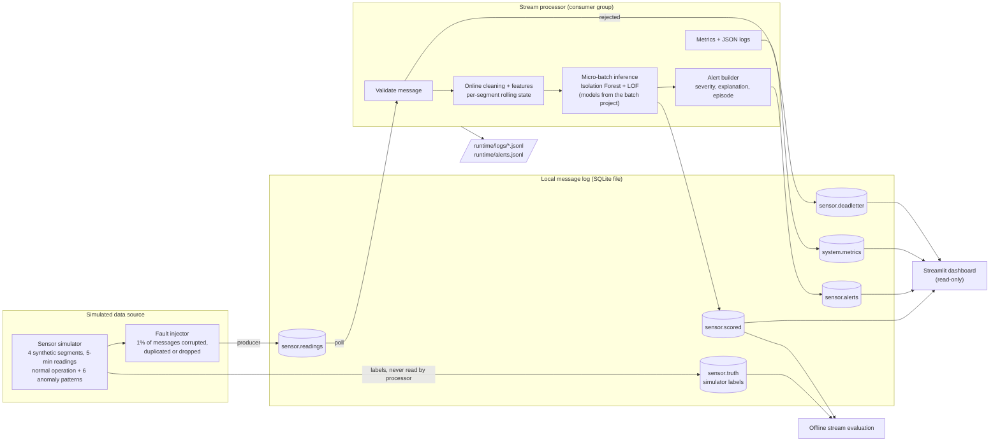

# Streaming architecture

> **Simulation, not infrastructure.** Everything described here runs on one machine with simulated sensor data.
> There is no connection to a real pipeline, SCADA system, cloud service or message cluster, and nothing is deployed.

## Diagram



## Why a local message log instead of Kafka or Redpanda

| Option | Assessment |
|---|---|
| Kafka | Needs a broker (plus controller), a client library and start-up orchestration. Justified for multi-team, high-volume, replicated streams; not for 4 simulated sensors on a laptop |
| Redpanda | Lighter than Kafka (single binary, Kafka API) but still an external service whose main value (durability, partitions, replication) this demo would not exercise |
| **SQLite-backed log (chosen)** | Standard library, zero services, safe for several processes sharing one file, works unchanged in Docker through a shared volume. Keeps the concepts that matter: topics, append-only log, offsets, consumer groups, replay |

`streaming/broker.py` defines a narrow `Broker` interface (`publish`, `poll`, `commit`, `read`, `tail`, `lag`).
A Kafka-backed class could implement the same interface without changes to the producer, processor or dashboard.
That implementation is **not** included and no Kafka compatibility is claimed.

What the local log does not provide: partitions, replication, retention policies, network transport, back-pressure,
authentication. It is a teaching-scale stand-in.

## Components

| # | Component | Module | Role |
|---|---|---|---|
| 1 | Sensor simulator | `streaming/simulator.py` (reuses `data_generation.py`) | Generates unseen simulated readings and labels |
| 2 | Producer | `streaming/producer.py` | Publishes readings at a set rate; injects transport faults; resumes the timeline after a restart |
| 3 | Ingestion layer | `streaming/broker.py` | Topics, offsets, consumer groups on a SQLite file |
| 4 | Consumer | `streaming/processor.py` | Polls micro-batches, commits offsets atomically with outputs |
| 5 | Validation | `streaming/messages.py` | Schema and range checks; rejects go to the dead-letter topic |
| 6 | Features | `streaming/online_features.py` | Incremental cleaning and feature computation, parity-tested against batch |
| 7 | Inference | `streaming/processor.py` + `detectors.py` | Scores with the fitted detectors from `models/detectors.joblib` |
| 8 | Alerts | `streaming/alerts.py` | Structured JSON alerts with severity band, explanation and episode |
| 9 | Monitoring | `streaming/metrics.py`, `logging_utils.py` | Latency percentiles, throughput, counters; JSON-lines logs |
| 10 | Dashboard | `dashboard/app.py` | Streamlit, auto-refreshing, read-only |
| 11 | Evaluation | `streaming/stream_eval.py` | Joins outputs with simulator labels after the run |

## Topics and message formats

| Topic | Written by | Content |
|---|---|---|
| `sensor.readings` | producer | One reading: `message_id`, `timestamp`, `segment_id`, `sensor_id`, `pressure_kpa`, `flow_m3h`, `temperature_c`, `operating_state`, `produced_at`, `simulated`. **No label fields** |
| `sensor.truth` | producer | Simulator labels per reading. Read only by the offline evaluation |
| `sensor.scored` | processor | One record per processed observation: cleaned readings, `status`, per-detector score / percentile / flag, `severity`, `alert_id`, data-quality notes, latency |
| `sensor.alerts` | processor | One structured alert per flagged observation (also appended to `runtime/alerts.jsonl`) |
| `sensor.deadletter` | processor | Rejected messages with a reason code and truncated payload |
| `system.metrics` | processor | Monitoring snapshot about once per second |

Observation `status` values: `scored`, `settling` (within 60 min of a state change; not monitored), `warming_up`
(not enough history), `not_usable` (missing data beyond the fill limit), `inference_error`.

## Processing workflow for one micro-batch

1. **Poll** up to `MAX_BATCH` (64) messages after the group's committed offset.
2. **Validate** each message. Invalid JSON, missing or unparseable timestamp, off-grid timestamp, unknown segment or
   unknown state → dead-letter. A missing, non-numeric or out-of-range sensor value → treated as missing.
3. **Order and gaps.** A timestamp already seen for the segment → duplicate, dropped. Older than the newest
   processed → late, dropped. A jump ahead → the missing 5-minute rows are inserted (as batch cleaning does).
4. **Clean.** Missing values are forward-filled from the past for at most 12 samples (one hour).
5. **Features.** The 16 model features are computed for the newest observation from a 256-sample buffer.
6. **Score** all scorable observations in the batch with one call per detector.
7. **Alert** if any detector exceeds its threshold (the 97th percentile of its training scores).
8. **Publish and commit** outputs and the consumer offset in a single transaction.

### Delivery guarantees

* Step 8 is atomic, so a crash cannot leave outputs for an input that will be read again: no duplicate outputs.
* Processor state (rolling buffers, episode tracker) is in memory. After a restart the processor resumes from the
  committed offset but must warm up again (~6 hours of simulated data per segment) before it scores.
* One processor instance per consumer group is assumed; there is no partition assignment.

## Consistency between training and streaming

A streaming system is only as good as the match between the features it computes live and the features the model
was trained on. Three things enforce that here:

1. **Same fitted objects.** The stream loads the detectors, thresholds and pressure-flow model saved by the batch pipeline.
2. **Parity tests.** `test_streaming_features_match_batch` feeds six days of data containing missing values, sentinel
   values and gaps through both code paths and requires identical readiness flags and feature values (to 1e-7).
   `test_streaming_scores_equal_batch_scores` requires identical anomaly scores.
3. **No look-ahead by construction.** The streaming engine only ever holds past observations.

Why the batch feature code was not simply called per message: recomputing pandas rolling windows on a 200-row
buffer took about 40 ms per message in a timing check, plus about 20 ms of scikit-learn overhead per call. The
incremental NumPy implementation takes a fraction of a millisecond.

## Why micro-batches

A scikit-learn scoring call has several milliseconds of fixed overhead whatever the number of rows. Scoring
observations one call at a time caps throughput at a few tens per second; scoring a polled batch together amortises
the overhead. At low rates batches naturally contain one or a few messages; under load they fill up. Inference is
pinned to one math thread because thread pools make tiny batches slower and far less predictable.

## Alerts

```json
{
  "alert_id": "ALT-SEG-B-20250703T0815",
  "observation_timestamp": "2025-07-03 08:15:00",
  "segment_id": "SEG-B", "sensor_id": "STN-102", "operating_state": "NORMAL",
  "severity": "medium",
  "anomaly_score_percentile": 0.9935,
  "detection_methods": ["Local Outlier Factor"],
  "detector_scores": {"Isolation Forest": {"score": 0.47, "percentile": 0.96, "threshold": 0.485, "flagged": false}, "...": {}},
  "readings": {"pressure_kpa": 3401.2, "flow_m3h": 799.6, "temperature_c": 12.31},
  "explanation": "Local Outlier Factor scored this observation at the 99.3th percentile of training-period scores (alert threshold: 97th). Largest deviations from typical values: ...",
  "top_deviations": [{"feature": "flow_vol_ratio", "robust_deviation": -6.1, "description": "flow rate is fluctuating less than usual (values barely changing)"}],
  "episode_id": "EP-SEG-B-20250703T0755", "episode_alert_number": 4,
  "latency_ms": {"feature_ms": 0.2, "inference_ms": 6.1, "processing_ms": 7.9, "end_to_end_ms": 24.0, "batch_size": 9},
  "simulated": true,
  "disclaimer": "Simulated data. Analytical notification for human review only; not an indication of a leak, equipment failure or safety incident."
}
```

(Illustrative layout; real examples from a run are in `reports/sample_alerts.json`.)

* **Severity** is a band on the score's percentile within the *training* score distribution: `low` ≥ 97th,
  `medium` ≥ 99th, `high` ≥ 99.7th. These are simulation thresholds chosen for this demo, not operational severities.
* **Explanation** lists the three features furthest from their training median, in plain language. It describes
  what deviated; it is not a diagnosis of cause.
* **Episodes** group flagged observations on the same segment that are less than 30 simulated minutes apart, so a
  reviewer can treat a run of alerts as one item.
* Alert wording is tested to contain no claim of a leak, failure or incident.

## Monitoring

| Measure | Definition |
|---|---|
| `feature_ms` | Validation + cleaning + feature computation for one message |
| `inference_ms` | Wall time of the detector calls for the message's micro-batch |
| `processing_ms` | Wall time from the start of the micro-batch until its outputs are built (what a message waits inside the processor) |
| `publish_ms` | Writing outputs and committing the offset |
| `end_to_end_ms` | From the producer stamping the message to the scored record being built; includes producer batching (50 ms ticks) and the 20 ms poll interval |
| Throughput | Messages per second: overall, recent window, and capacity (messages ÷ time spent processing) |
| Counters | Received, processed, scored, flagged, alerts, rejected (by reason), duplicates, late, gap rows, filled values, errors |

Latency percentiles are computed over the most recent 5,000 observations. All timings use `time.perf_counter`
inside the running process. Logs are JSON lines (`processor_started`, `observation_scored`, `alert_created`,
`message_rejected`, `processing_error`, …) written to stdout and `runtime/logs/`.

## Simulated versus real

| In this project | In a real deployment (not built here) |
|---|---|
| Simulator replaying generated data much faster than real time | Field instruments and a historian or telemetry gateway |
| SQLite file as message log | Replicated broker with partitions, retention and access control |
| One processor, in-memory state | Several instances, checkpointed state, exactly-once sinks |
| Models trained once on synthetic data | Models validated on real history, monitored for drift, retrained under change control |
| Dashboard for a demo | Integration with existing operator tools and alarm management practice |
| Labels available from the simulator | No ground truth; alerts judged by specialists |
